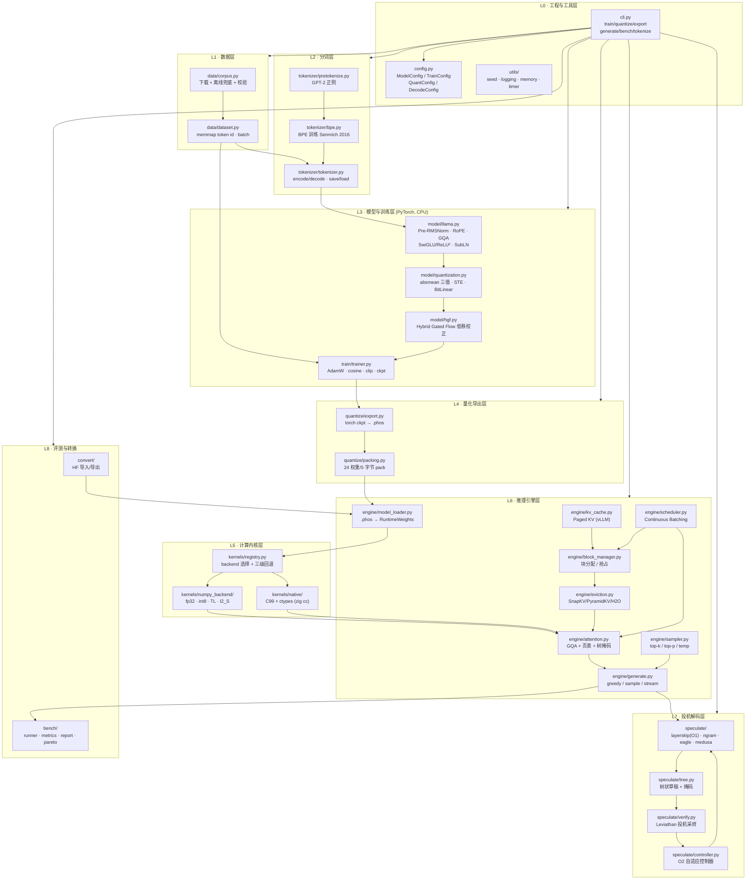
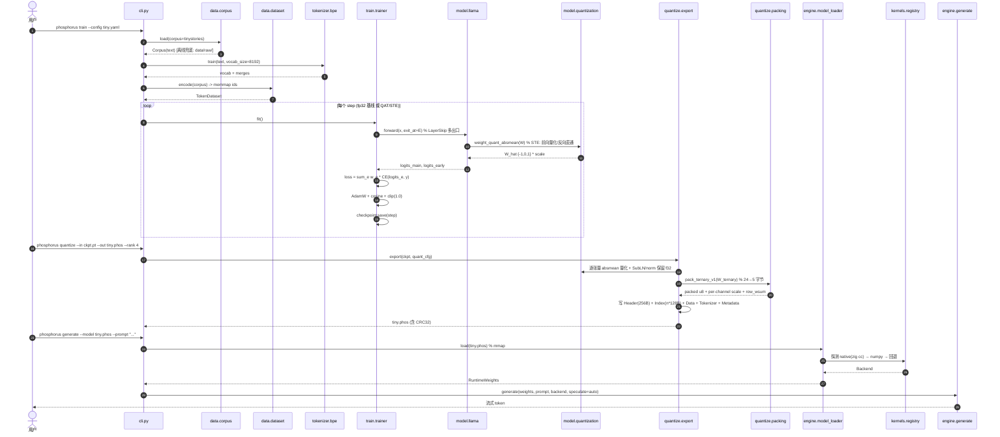
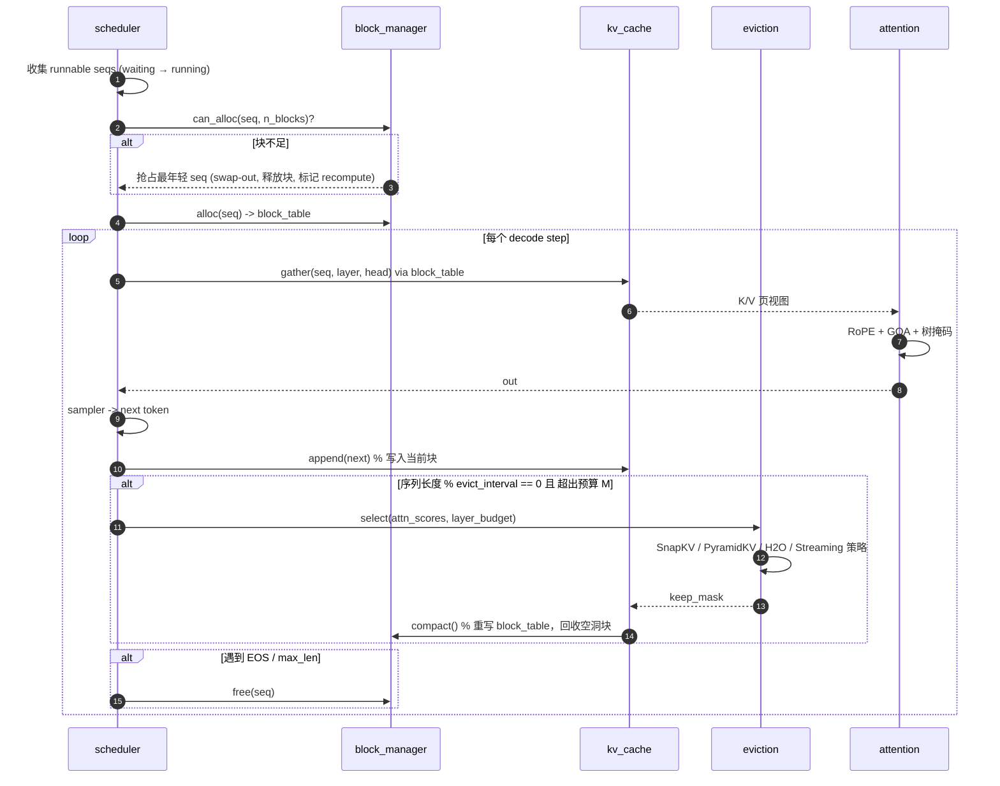
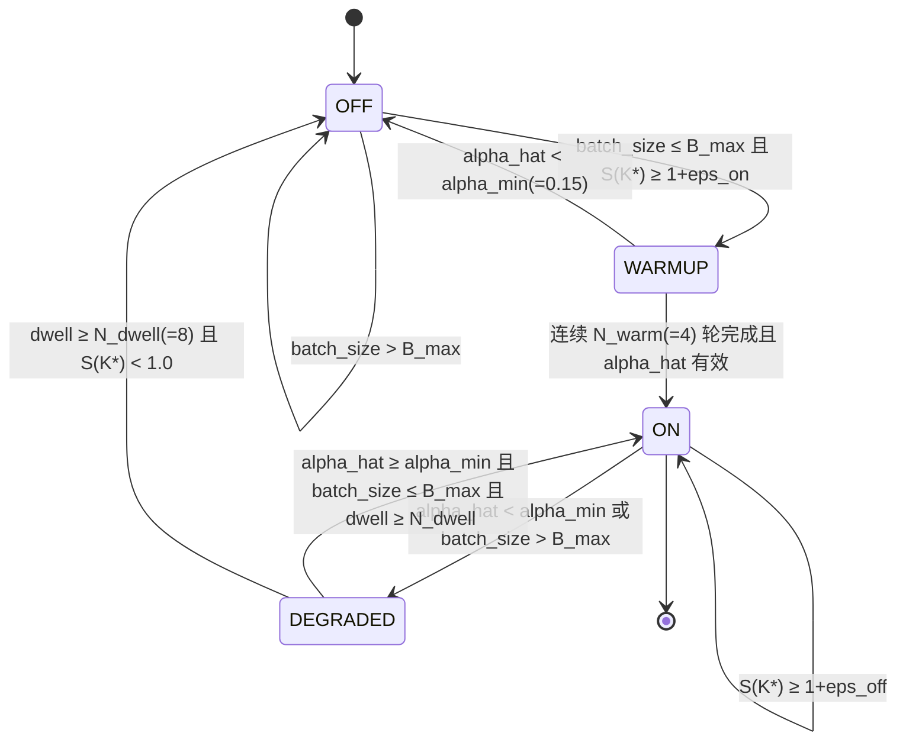
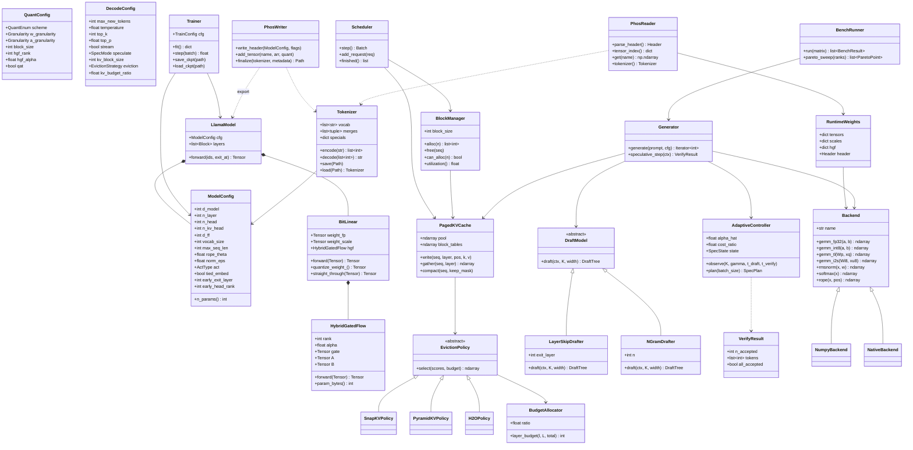

# Phosphorus 系统架构设计

> **Phosphorus（晨星）** — 三值原生（1.58-bit / BitNet b1.58）LLM 的**训练 + 投机解码推理引擎**
> 单进程 CPU 可跑 · 零 GPU 依赖 · 零系统编译器依赖 · 可量化评测
> 作者：晨星（GitHub: [CJX0712](https://github.com/CJX0712)） · License: Apache-2.0
> 文档版本：v1.0（对应 `.phos` 格式 version 1.0）

---

## 0. 设计总纲

### 0.1 三条不可违背的红线

| 红线 | 具体含义 | 落地手段 |
|---|---|---|
| **禁重复造轮子** | 凡有顶级现成方案（论文/开源项目）必须显式复用并注明来源 | `docs/ALGORITHMS.md` 每张表都要有「来源 + 链接 + 选型理由 + 我们的超越点」四列 |
| **最小可用优先** | 模型 / 语料 / 训练步数必须在纯 CPU 上几分钟跑完并给出真实数字 | 默认 `d_model=384, n_layer=6, vocab=8192`（≈10M 参数），`--scale {tiny,small,base}` 可放大 |
| **不变量优先于功能** | 每个模块先定义可验证的**不变量**，再写功能代码 | `tests/` 中 7 条核心不变量（见 §7），CI 必跑 |

### 0.2 四个原创超越点（O1–O4）

| ID | 名称 | 一句话 | 可量化交付 |
|---|---|---|---|
| **O1** | 三值原生自草稿投机解码 | 不训练第二个草稿模型，复用目标模型前 E 层 + 早退 head，且**草稿路径跑在同一份三值权重上** | 草稿模型额外参数 = 0（`--early-head-rank 0`），额外显存 = 0 |
| **O2** | 自适应投机控制器 | 在线测 α 与 batch，动态调 K / 树宽 / **是否开启**；低于阈值自动关闭 | `speedup=(1+αK)/(1+ε)` 闭式模型 + 在线拟合；给出「开启/关闭」决策日志 |
| **O3** | 质量-内存 Pareto 旋钮 | HGF 低秩校正秩 r ∈ {0,1,2,4,8,16}，输出 PPL vs 内存曲线 | `bench pareto` 输出 ASCII 曲线 + JSON |
| **O4** | 零编译器依赖的原生内核 | C99 内核用 `python -m ziglang cc` 编译（pip 可装，Win/Mac/Linux 通吃），失败自动回退 NumPy | `scripts/setup.sh` 无需 apt/msvc；`PHOS_BACKEND=auto` 三级回退 |

### 0.3 环境硬约束（已实测，设计必须遵守）

- 无 GPU：全部路径 CPU-only；模型规模 5M–30M 参数。
- **无系统 C 编译器**：MSVC / gcc 路径不可用。所有 C 代码经 `python -m ziglang cc -O2` 编译。
- Windows 开发，Linux/macOS 必须同样跑通（CI: `ubuntu-latest`）。
- `pip` 必须带 `NO_PROXY='*' no_proxy='*'`。
- Python venv：`C:/Users/Administrator/.workbuddy/binaries/python/envs/phos/Scripts/python.exe`（numpy 2.5.4 / pytest / ziglang 0.16.0；torch CPU 版）。
- C 内核**不使用 OpenMP / pthread**（可移植性风险），并行由 Python `ThreadPoolExecutor` 在 row-block 粒度切分 + `ctypes` 释放 GIL 实现。

---

## 1. 总体分层架构



### 1.1 分层职责边界（铁律）

| 层 | 允许依赖 | 禁止依赖 |
|---|---|---|
| L0 工具 | stdlib | 任何上层 |
| L1/L2 数据分词 | numpy, stdlib | torch, 内核层 |
| L3 训练 | torch, numpy | 内核层、引擎层（训练期只用 torch 算子） |
| L4 导出 | torch(仅读 ckpt), numpy | 引擎层 |
| L5 内核 | numpy / ctypes | torch、引擎层 |
| L6 引擎 | L5, numpy | torch（**运行时零 torch 依赖**，保证 CPU 推理可独立安装） |
| L7 投机 | L6 | torch |
| L8 评测 | L6, L7, numpy | torch（除 HF 转换外） |

> **关键设计决策**：L6 运行时**不依赖 PyTorch**。装上 `core` 分组即可推理，装 `train` 分组才能训练。这让「零 GPU 依赖 + 几分钟跑完」成为可安装的现实。

---

## 2. 模块清单

### 2.1 完整文件树

```
phosphorus/
├── pyproject.toml                     # 可选依赖分组 core/train/native/bench/convert/dev
├── Makefile                           # install / test / lint / build-native / bench
├── README.md                          # 中文为主 + 徽章
├── LICENSE                            # Apache-2.0
├── CITATION.cff
├── .gitignore
├── ruff.toml
├── scripts/
│   ├── setup.sh                       # Linux/macOS: venv + pip(NO_PROXY='*') + 内核编译
│   └── setup.ps1                      # Windows 等价
├── .github/workflows/ci.yml           # ubuntu-latest, py3.10/3.11/3.12
├── phosphorus/
│   ├── __init__.py                    # __version__, backend 探测
│   ├── __main__.py                    # python -m phosphorus
│   ├── cli.py                         # argparse 子命令分发
│   ├── config.py                      # 全部 dataclass 配置 + YAML/JSON 序列化
│   ├── utils/{__init__,seed,logging,memory,timer}.py
│   ├── data/{__init__,corpus,dataset}.py
│   ├── tokenizer/{__init__,pretokenize,bpe,tokenizer}.py
│   ├── model/{__init__,config,modules,llama,quantization,hgf}.py
│   ├── train/{__init__,trainer,lr_scheduler,checkpoint}.py
│   ├── quantize/{__init__,packing,export,inspect}.py
│   ├── kernels/
│   │   ├── {__init__,registry}.py
│   │   ├── numpy_backend/{__init__,gemm,ops}.py
│   │   └── native/
│   │       ├── phos_gemm.c / phos_gemm.h
│   │       ├── phos_ops.c  / phos_ops.h
│   │       ├── phos_pack.c / phos_pack.h
│   │       ├── build.py               # zig cc 编译 + 缓存 + 失败回退
│   │       └── bindings.py            # ctypes 绑定 + GIL 释放
│   ├── engine/
│   │   ├── {__init__,model_loader,block_manager,kv_cache,eviction,
│   │   │    scheduler,attention,sampler,generate}.py
│   ├── speculate/
│   │   ├── {__init__,base,layerskip,ngram,eagle,medusa,tree,verify,controller}.py
│   ├── bench/{__init__,runner,metrics,report,pareto}.py
│   ├── convert/{__init__,hf_import,hf_export}.py
├── tests/
│   ├── conftest.py
│   ├── test_bpe.py                    # 不变量 ⑤
│   ├── test_packing.py                # 不变量 ③
│   ├── test_gemm_bitwise.py           # 不变量 ①
│   ├── test_rope.py                   # 不变量 ④
│   ├── test_qat_ste.py                # 不变量 ⑥
│   ├── test_speculative_distribution.py  # 不变量 ②
│   ├── test_kv_eviction.py            # 不变量 ⑦
│   ├── test_native_backend.py
│   ├── test_phos_roundtrip.py
│   ├── test_engine_parity.py
│   └── test_controller.py
├── data/raw/                          # 内置极小语料（随仓库提交，离线兜底）
└── docs/
    ├── ARCHITECTURE.md                # 本文
    ├── ALGORITHMS.md                  # 借鉴来源 + 超越点
    ├── TASKS.md                       # 任务分解
    ├── API.md
    ├── BENCHMARKS.md
    └── CONTRIBUTING.md
```

### 2.2 模块职责 / 输入 / 输出 / 关键数据结构

| 模块 | 职责 | 输入 | 输出 | 关键数据结构 |
|---|---|---|---|---|
| `data.corpus` | 语料获取；优先内置 `data/raw/*.txt`，缺则下载 tinyshakespeare/TinyStories 子集，下载失败用内置兜底 | `--corpus {builtin,tinystories,shakespeare,path}` | 原始文本 + sha256 记录 | `Corpus(text:str, name:str, sha256:str, n_chars:int)` |
| `data.dataset` | token id → memmap；滑窗 batch；可复现 shuffle | `np.memmap`, `block_size` | `(x,y)` int32 batch | `TokenDataset(path, block_size, stride)` |
| `tokenizer.pretokenize` | GPT-2 预分词正则 + 字节级映射 | str | `list[str]` | `GPT2_PAT`, `bytes_to_unicode()` |
| `tokenizer.bpe` | BPE 训练（Sennrich 2016 合并对统计 + 优先级队列） | 语料, `vocab_size` | `merges: list[(str,str)]`, `vocab` | `BPETrainer(vocab_size, min_freq)` |
| `tokenizer.tokenizer` | encode/decode/特殊 token/保存加载 | str ↔ `list[int]` | `Tokenizer` | `Tokenizer(vocab, merges, specials, unk_id)` |
| `model.modules` | RMSNorm / SubLN / RotaryEmbedding / GQA-Attn / MLP | tensor | tensor | `RMSNorm`, `SubLN`, `Rotary`, `ReLU2` |
| `model.llama` | LLaMA 主体；多出口（O1 早退）；tied embedding | ids, `exit_layer` | logits 或 hidden | `LlamaModel.forward(..., exit_at=None)` |
| `model.quantization` | absmean 三值量化 + STE + BitLinear 替换 | fp32 Linear | 量化 Linear | `weight_quant_absmean`, `activation_quant`, `BitLinear`, `QATStraightThrough` |
| `model.hgf` | HGF 低秩校正通路（O3） | hidden | 校正增量 | `HybridGatedFlow(d_in,d_out,rank,alpha,gate)` |
| `train.trainer` | AdamW + cosine + grad clip + AMP-off + ckpt + LayerSkip 多出口损失 | `TrainConfig` | ckpt + metrics | `Trainer.step()`, `Trainer.fit()` |
| `quantize.packing` | 三值 5-bit pack/unpack（24→5 字节） | `int8[N]` | `uint8` | `pack_ternary_v1`, `unpack_ternary_v1` |
| `quantize.export` | ckpt → `.phos`（含 HGF、row_wsum、tokenizer、metadata） | ckpt, `QuantConfig` | `.phos` | `PhosWriter`, `TensorEntry` |
| `kernels.registry` | 后端选择：`native → numpy → pure-python` 三级回退 | `PHOS_BACKEND` | 具体 GEMM/ops 实现 | `Backend(name, gemm_tbl, gemm_i2s, ...)` |
| `kernels.numpy_backend.gemm` | fp32 / int8 / TL(LUT) / I2_S 四种 GEMM | W(packed 或 int8), x | y | `gemm_fp32`, `gemm_int8`, `gemm_tl`, `gemm_i2s` |
| `kernels.native` | C99 内核：TL GEMM、I2_S GEMM、RMSNorm、softmax、RoPE、pack/unpack | ctypes 数组 | 结果数组 | `phos_tl_gemm(...)` 等 C ABI |
| `engine.model_loader` | `.phos` mmap 加载 → 运行时权重视图 | 文件路径 | `RuntimeWeights` | `RuntimeWeights(tensors:dict, meta:dict)` |
| `engine.block_manager` | 页块分配/释放/抢占（PagedAttention） | 请求 | `block_table: int32[S, Bmax]` | `BlockManager(alloc, free, can_alloc)` |
| `engine.kv_cache` | 分页 KV 物理池 + 逻辑→物理映射 + int8 量化 KV | layer, head, pos | K/V 视图 | `PagedKVCache(kv:uint8, scales, block_tables)` |
| `engine.eviction` | SnapKV / PyramidKV / H2O / StreamingLLM / None + 预算分配器 | attn scores, budget | `keep_mask` | `EvictionPolicy.select()`, `BudgetAllocator.layer_budget()` |
| `engine.scheduler` | 连续批处理；prefill/decode 混合；抢占回收 | `Seq[]` | `Batch` | `Scheduler.step() -> Batch` |
| `engine.attention` | GQA 注意力 + 分页 gather + 树掩码 + RoPE | q, block_table, mask | out | `paged_gqa_attention(...)` |
| `engine.sampler` | temperature / top-k / top-p / min-p | logits | next id | `Sampler.sample(logits, rng)` |
| `engine.generate` | 生成主循环；流式回调 | prompt | token 流 | `Generator.generate(..., stream=True)` |
| `speculate.base` | 草稿生成器协议 | context | `DraftTree` | `DraftModel.draft(ctx) -> DraftTree` |
| `speculate.layerskip` | **O1**：前 E 层 + 早退 head，走同一份三值权重 | ctx | `DraftTree` | `LayerSkipDrafter(model, exit_layer, K, width)` |
| `speculate.ngram` | n-gram / prompt-lookup 零成本草稿（llama.cpp PR#18471） | prompt | `DraftTree` | `NGramDrafter(ngram_n=3, max_draft=8)` |
| `speculate.tree` | 树状草稿构造 + 掩码生成（EAGLE-2 式按概率剪枝） | 候选序列 | 掩码 + 位置 | `build_tree(paths)`, `tree_mask(paths)` |
| `speculate.verify` | Leviathan 投机采样验证（严格分布等价） | draft tokens, target probs | accepted 数 + 修正 token | `speculative_verify(...)` |
| `speculate.controller` | **O2**：在线拟合 α、c；K/树宽/开关决策 + 状态机 | 每步观测 | `SpecPlan(K, width, enabled)` | `AdaptiveController.observe()`, `.plan()` |
| `bench.runner` | 跑基准矩阵（fp32/int8/三值/三值+投机 × 批大小 × 序列长） | 配置 | `BenchResult[]` | `BenchResult(tokens_per_s, ms_per_token, ttft_ms, rss_mb, ppl, alpha, speedup)` |
| `bench.report` | JSON + Markdown 表 + ASCII 柱状图 | 结果 | 三份产物 | `render_json/md/ascii()` |
| `bench.pareto` | **O3**：r 扫描 → PPL vs 内存 Pareto | r 列表 | 曲线 | `pareto_sweep(ranks)` |
| `convert.hf_*` | HF `transformers` ↔ `.phos` / ckpt 互转 | safetensors | 目标格式 | `import_hf()`, `export_hf()` |

---

## 3. `.phos` 二进制模型格式（version 1.0）

**字节序：小端（LE）**。**对齐：64 字节**。**所有偏移均为距文件开头的绝对字节偏移**。整数用定宽 `u32/u64`，浮点用 IEEE-754 `f32`。

### 3.1 布局总览

```
┌──────────────────────────────┬────────────────────────────────┐
│ Header            256 B      │ 固定，含 CRC32                  │
├──────────────────────────────┼────────────────────────────────┤
│ Tensor Index  n×128 B        │ 张量目录                        │
├──────────────────────────────┼────────────────────────────────┤
│ (pad to 64)                  │                                │
├──────────────────────────────┼────────────────────────────────┤
│ Data Region                  │ 每个张量: data | scale | aux    │
│   每个子块 64 B 对齐          │  aux = HGF(A,B) 或 row_wsum    │
├──────────────────────────────┼────────────────────────────────┤
│ Tokenizer Blob              │ u32 len + UTF-8 JSON            │
├──────────────────────────────┼────────────────────────────────┤
│ Metadata JSON               │ u32 len + UTF-8 JSON            │
└──────────────────────────────┴────────────────────────────────┘
```

### 3.2 Header（256 B，精确字段偏移）

| Off | Size | Type | 字段 | 说明 |
|---:|---:|---|---|---|
| 0 | 4 | `u8[4]` | `magic` | `50 48 4F 53` = `"PHOS"` |
| 4 | 1 | `u8` | `version_major` | `1` |
| 5 | 1 | `u8` | `version_minor` | `0` |
| 6 | 1 | `u8` | `endian` | `0` = little-endian |
| 7 | 1 | `u8` | `alignment` | `64` |
| 8 | 4 | `u32` | `header_bytes` | `256` |
| 12 | 4 | `u32` | `index_entry_bytes` | `128` |
| 16 | 8 | `u64` | `file_bytes` | 文件总字节数 |
| 24 | 8 | `u64` | `flags` | 见 §3.3 |
| 32 | 4 | `u32` | `n_layer` | 层数 L |
| 36 | 4 | `u32` | `d_model` | d |
| 40 | 4 | `u32` | `n_head` | 查询头数 H |
| 44 | 4 | `u32` | `n_kv_head` | KV 头数（GQA）H_kv |
| 48 | 4 | `u32` | `d_head` | d/H |
| 52 | 4 | `u32` | `d_ff` | FFN 隐层 |
| 56 | 4 | `u32` | `vocab_size` | V |
| 60 | 4 | `u32` | `max_seq_len` | 上下文上限 |
| 64 | 4 | `f32` | `rope_theta` | 默认 10000.0 |
| 68 | 4 | `f32` | `norm_eps` | 默认 1e-5 |
| 72 | 4 | `u32` | `act_enum` | `0`=SwiGLU, `1`=ReLU² |
| 76 | 4 | `u32` | `quant_enum` | `0`=fp32, `1`=int8, `2`=ternary |
| 80 | 4 | `u32` | `w_granularity` | `0`=per_tensor, `1`=per_channel(按输出行), `2`=per_block |
| 84 | 4 | `u32` | `w_block_size` | per_block 块大小，默认 128 |
| 88 | 4 | `u32` | `a_granularity` | `0`=per_tensor, `1`=per_token, `2`=per_block |
| 92 | 4 | `u32` | `pack_scheme` | `0`=none, `1`=ternary_5bit_v1（本文 §3.6） |
| 96 | 4 | `u32` | `hgf_rank` | O3 全局默认秩 r |
| 100 | 4 | `f32` | `hgf_alpha` | 缩放 α（默认 1.0，配合 `/r` 归一化） |
| 104 | 4 | `f32` | `hgf_gate_init` | 门控初值（默认 0.05，可训练） |
| 108 | 4 | `u32` | `kv_block_size` | 分页 KV 块大小（默认 16） |
| 112 | 4 | `u32` | `n_tensor` | 张量条目数 n |
| 116 | 4 | `u32` | `early_exit_layer` | **O1** 早退层号 E（无则 `0xFFFFFFFF`） |
| 120 | 8 | `u64` | `tensor_index_off` | 默认 `256` |
| 128 | 8 | `u64` | `tokenizer_off` | 0 = 无 |
| 136 | 8 | `u64` | `tokenizer_bytes` | |
| 144 | 8 | `u64` | `metadata_off` | |
| 152 | 8 | `u64` | `metadata_bytes` | |
| 160 | 8 | `u64` | `data_region_off` | |
| 168 | 8 | `u64` | `data_region_bytes` | |
| 176 | 4 | `u32` | `crc32_header` | CRC32(字节 `[0,176)`) |
| 180 | 4 | `u32` | `reserved1` | 0 |
| 184 | 72 | `u8[72]` | `reserved_zero` | 全 0，补齐到 256 |

### 3.3 `flags` 位定义

| Bit | 名称 | 含义 |
|---:|---|---|
| 0 | `HAS_HGF` | 至少一个张量带 HGF 低秩因子 |
| 1 | `TIED_EMBED` | `lm_head.weight` 与 `tok_emb` 共享（不重复存储） |
| 2 | `HAS_TOKENIZER` | 含 tokenizer blob |
| 3 | `HAS_ROW_WSUM` | 含每输出行的 `Σ_j W[i,j]`（int32），供 I2_S 零点校正 |
| 4 | `HAS_EARLY_HEAD` | 含 O1 早退头（`{E}.early_head.*`） |
| 5 | `KV_INT8` | KV cache 默认 int8 |
| 6 | `HAS_INT8_MIRROR` | 额外存一份 int8 镜像权重，供 I2_S 快速路径 |
| 7 | `HAS_SCALES_F16` | scale 以 f16 存储（否则 f32） |
| 8 | `QUANT_EMBED` | 嵌入表也被量化 |
| 9–63 | — | 保留 |

### 3.4 Tensor Index Entry（128 B / 条）

| Off | Size | Type | 字段 | 说明 |
|---:|---:|---|---|---|
| 0 | 32 | `char[32]` | `name` | 见 §3.5 命名规范，UTF-8，`\0` 填充 |
| 32 | 1 | `u8` | `dtype` | `0`=f32 `1`=f16 `2`=bf16 `3`=int8 `4`=uint8 `5`=int32 `6`=TERNARY_PACKED |
| 33 | 1 | `u8` | `ndim` | 1–4 |
| 34 | 1 | `u8` | `pack_scheme` | 同 header，逐张量覆盖 |
| 35 | 1 | `u8` | `tflags` | bit0 packed / bit1 has_scale / bit2 has_hgf / bit3 has_row_wsum |
| 36 | 16 | `u32[4]` | `shape` | shape[0..3]，不足补 0（行主序 C-order） |
| 52 | 4 | `u32` | `n_elements` | **打包前**逻辑元素数 |
| 56 | 4 | `u32` | `scale_dtype` | `0`=none `1`=f32 `2`=f16 |
| 60 | 4 | `u32` | `n_scale` | scale 个数（per_channel = shape[0]，per_tensor = 1） |
| 64 | 8 | `u64` | `data_off` | 64 B 对齐 |
| 72 | 8 | `u64` | `data_bytes` | |
| 80 | 8 | `u64` | `scale_off` | 4 B 对齐（块尾补 64） |
| 88 | 8 | `u64` | `scale_bytes` | |
| 96 | 8 | `u64` | `aux_off` | HGF `A∥B` 或 `row_wsum`，64 B 对齐 |
| 104 | 8 | `u64` | `aux_bytes` | |
| 112 | 4 | `u32` | `hgf_rank` | 本张量秩（0 = 无 HGF） |
| 116 | 4 | `u32` | `aux_layout` | `0`=无 `1`=`A[r,d_in]∥B[d_out,r]` (f16) `2`=`row_wsum_i32[d_out]` |
| 120 | 8 | `u64` | `reserved` | 0 |

### 3.5 张量命名规范

```
tok_emb                                   [V, d]        f16（QUANT_EMBED 时 int8/ternary）
norm_final                                [d]           f32
lm_head                                   [V, d]        f16（TIED_EMBED 时不存储）
layers.{i}.attn_norm                      [d]           f32   SubLN before Q/K
layers.{i}.ffn_norm                       [d]           f32
layers.{i}.attn.q_proj.weight             [d, d]        ternary
layers.{i}.attn.k_proj.weight             [d_kv, d]     ternary   d_kv = n_kv_head*d_head
layers.{i}.attn.v_proj.weight             [d_kv, d]     ternary
layers.{i}.attn.o_proj.weight             [d, d]        ternary
layers.{i}.attn.subln_out                 [d]           f32   BitNet SubLN on attn out
layers.{i}.mlp.gate_proj.weight           [d_ff, d]     ternary
layers.{i}.mlp.up_proj.weight             [d_ff, d]     ternary
layers.{i}.mlp.down_proj.weight           [d, d_ff]     ternary
layers.{i}.mlp.subln_out                  [d]           f32
layers.{E}.early_head.lora_a              [d, r]        f16   仅 HAS_EARLY_HEAD 且 r>0
layers.{E}.early_head.lora_b              [r, V]        f16
```

> `q/k/v/o/gate/up/down` 亦可带 `.scale`（per-channel 时 `[d_out]`，per_tensor 时 `[1]`）与 `.row_wsum`（`[d_out]` int32），这些**不占独立 index 条目**，走 entry 的 `scale_off` / `aux_off`。

### 3.6 三值权重 5-bit 打包布局（`ternary_5bit_v1`）★ 本项目核心

**基本单元：24 个三值权重 → 5 字节**（= 1.667 bit/weight，与 BitNet 理论下界 `log2(3)=1.585` 仅差 5.2%）。

**Step 1 · 数字映射**：`w ∈ {-1,0,1} → d ∈ {0,1,2}`（`-1→0, 0→1, +1→2`）

**Step 2 · 3 个权重一组 → base-3 码**
```
c = d0 + 3*d1 + 9*d2          // c ∈ [0, 26]，共 27 态
```

**Step 3 · 符号-索引编码（1 bit 符号 + 4 bit 索引）**
利用对称约简 `27 = 1（全零） + 13×2（互为相反数）` → **14 个规范型**，4 bit 索引足够（16 ≥ 14）：
```
if c == 13:                    # 全零 (d=1,1,1)
    index, sign = 0, 0
elif c <= 12:                  # 规范型恰好是 c ∈ [0,12]
    index, sign = c + 1, 0
else:                          # c ∈ [14,26]，取相反数 26-c ∈ [0,12]
    index, sign = (26 - c) + 1, 1

code5 = (sign << 4) | index    # index ∈ [0,13]，5 bit
```

**Step 4 · 组打包（8 组 → 40 bit = 5 字节）**
```
u64 v = 0;
for g in 0..7:  v |= (u64)code5[g] << (5*g);   // 40 bit 有效
memcpy(out, &v, 5);                            // 小端写出低 5 字节
```

**Step 5 · 行对齐**
矩阵行宽 `K` 补齐到 **24 的倍数**：`K_pad = ceil(K/24)*24`，补 0 权重。
单行打包字节数 `= K_pad * 5 / 24`（整数，5 字节的倍数，LUT chunk 天然对齐）。
全矩阵 `packed_bytes = n_rows * K_pad * 5 / 24`。

**解包（供参考实现 / 测试）**
```
byte_off = (row * K_pad/24) * 5 + (group/8)*5
bit_off  = (group % 8) * 5
code5    = (u16)(load48bits(byte_off) >> bit_off) & 0x1F   // 读 6 字节防跨界
```

> **为什么用「符号+索引」而非直接 base-3？** 直接 base-3（0..26）需要 27 项 LUT；符号+索引只需 **14 项**（补齐 16），LUT 恰好 16 项 —— 在 SIMD 上 16×int8 正好一个 XMM 寄存器、16×int16 正好可用「双 pshufb 高低字节表」技巧查表，符号用一条 `_mm256_sign_epi8/epi16` 施加。这是本项目对 bitnet.cpp `three_lut` 的**微架构级超越点**（详见 `docs/ALGORITHMS.md` A-3 条目）。

### 3.7 HGF 低秩因子布局

`aux_layout = 1` 时，aux 区为 `A[r, d_in] ∥ B[d_out, r]`，均 f16，行主序，`A` 先 `B` 后，整体 64 B 对齐。
前向：`y = (ternary_matmul(W, x) * scale) + gate * (alpha/r) * (B @ (A @ x))`

**内存开销公式**（相对三值打包字节）：
```
overhead% = r * (d_in + d_out) * bytes_per_param / (d_in * d_out * 1.667 / 8) * 100
```
以 `d_in=d_out=512`、f16(2B) 为例：`r=1→3.75%`，`r=2→7.5%`，`r=4→15%`，`r=8→30%`，`r=16→60%`。
→ **默认 r=4 落在 PRD 要求的「12–15% 额外内存」区间**。Pareto 扫描 `r ∈ {0,1,2,4,8,16}`。

### 3.8 Tokenizer Blob

```
[u32 json_bytes][UTF-8 JSON]
```
```jsonc
{
  "type": "bpe", "version": 1,
  "pretokenizer": "gpt2",
  "byte_level": true,          // GPT-2 bytes_to_unicode，保证任意 UTF-8 无损
  "vocab": ["<|bos|>", "..."],  // 下标即 id
  "merges": ["a b", "b c"],     // 有序，rank = 下标
  "specials": {"<|bos|>": 0, "<|eos|>": 1, "<|pad|>": 2},
  "unk_id": 3,
  "vocab_size": 8192
}
```

### 3.9 Metadata JSON

```jsonc
{
  "created_at": "2026-10-16T...Z",
  "generator": "phosphorus 0.1.0",
  "git_sha": "...",
  "source_ckpt": "ckpt/tiny-qat-step20000.pt",
  "torch_version": "2.x",
  "train": {"steps": 20000, "lr": 3e-3, "final_loss": 3.41, "val_ppl": 18.7},
  "quant": {"scheme": "absmean", "granularity": "per_channel", "hgf_rank": 4, "qat": true},
  "pareto": [{"r": 0, "ppl": 21.3, "bytes": 5461300}, ...],
  "license": "Apache-2.0",
  "author": "晨星 CJX0712"
}
```

---

## 4. 关键时序图

### 4.1 训练 → 量化导出 → 推理 全链路



### 4.2 投机解码一轮（含树草稿与验证）★ O1 + O2

```mermaid
sequenceDiagram
    autonumber
    participant G as engine.generate
    participant C as speculate.controller
    participant D as speculate.layerskip (O1)
    participant T as speculate.tree
    participant M as 目标模型 (三值)
    participant V as speculate.verify (Leviathan)

    G->>C: plan(batch_size, hist_alpha)
    C->>C: 读取 EWMA: alpha_hat, cost_ratio c
    C->>C: 枚举 K∈[0..Kmax], 取 argmax S(K)
    alt S(K*) < 1+eps 或 batch > Bmax
        C-->>G: SpecPlan(enabled=false, K=0)
        Note over G,M: 退化为普通自回归一步
    else 开启投机
        C-->>G: SpecPlan(enabled=true, K=K*, width=w)
    end

    G->>D: draft(ctx, K*, w)
    D->>M: 只跑前 E 层 (同一份三值权重!)
    D->>M: early_head(hidden_E) -> probs
    D-->>T: 候选 token 序列 (K* 步, 每步 top-w)
    T->>T: 按联合概率剪枝 (joint_prob < tau 丢弃)
    T-->>G: DraftTree(paths, mask, positions)

    G->>M: verify_forward(tree)  % 一次 batched prefill
    M-->>V: target_probs[每个树节点]
    V->>V: Leviathan 逐个节点: r~U(0,1);<br/>accept if r < min(1, p_t/q_d);<br/>else 用 max(0,p_t-q_d) 重采样修正
    V-->>G: accepted_paths (γ 个 token) + bonus token

    G->>C: observe(K_actual=K*, gamma=γ, t_draft, t_verify)
    C->>C: alpha_hat ← β*alpha_hat + (1-β)*γ/K*<br/>c ← EWMA(t_draft/t_verify)
    G->>G: 提交 γ+1 个 token 到 KV (分页写入)
    Note over G: 若 γ==0，bonus token 保证每轮至少前进 1 步
```

### 4.3 连续批处理 + 分页 KV + 驱逐



---

## 5. 三值 GEMM 内核

### 5.0 公共前提

- 权重 `W ∈ {-1,0,1}`，按 §3.6 打包为 5-bit 流（或镜像为 int8 `{-1,0,1}`）。
- 激活按 token/channel 量化为 **8-bit**：`xq = round(clip(x / sx, -127, 127))`，`sx` 为 `per_token`（BitNet 默认）或 `per_tensor` 缩放。
- **两者都在整数域运算 → 结果与 fp32 参考在量化域内逐位无损**（不变量 ①）。
- 输出 `y_i = sx * sy_i * (Σ_j W[i,j] * xq_j)`；`sy_i` 为权重 per-channel scale。

### 5.1 TL（Ternary LUT）内核 — 查表法，内存受限场景首选

```c
// 伪代码 (C99, 可移植标量路径为权威实现)
// W: packed 5-bit, [N, K_pad] ; xq: int8[K] ; lut 每 3 个激活重建一次
void phos_tl_gemm(const uint8_t* W, const int8_t* xq, const f32* scale,
                  f32* y, int N, int K, int32_t* /*scratch*/) {
    const int NG = K_pad / 3;                 // 每组 3 个权重
    for (int n = 0; n < N; ++n) {             // 行并行：交给 Python 线程池
        const uint8_t* row = W + (size_t)n * (K_pad * 5 / 24);
        int32_t acc = 0;  int16_t acc16 = 0;
        for (int g = 0; g < NG; ++g) {
            uint8_t code5 = unpack5(row, g);  // 见 §3.6 Step 5
            // --- 建表（每 24 组一次，8 组共享 48 个激活）---
            if ((g & 7) == 0) build_lut16(xq + 3*g, lut);   // 见下
            int16_t p = lut[code5 & 0x0F];                  // 0..13 有效
            acc16 += (code5 & 0x10) ? (int16_t)(-p) : p;    // 符号位
            if ((g & 63) == 63) { acc += (int32_t)acc16; acc16 = 0; }  // 防 int16 溢出
        }
        acc += (int32_t)acc16;
        y[n] = (f32)acc * scale[n] * sx;
    }
}

// 规范 LUT 构建：14 项（补齐 16），int16 存储
// 令 a = (xq[3g], xq[3g+1], xq[3g+2])，base-3 码 c = d0+3d1+9d2 对应部分和
//   part(c) = Σ_k (digit(c,k) - 1) * a[k]        // digit∈{0,1,2} → w∈{-1,0,1}
// lut[0] = 0                                     // 全零
// for c in 0..12:  lut[c+1] = part(c)
// 对称性保证 part(26-c) = -part(c)，故只需 13 项 + 符号位
static void build_lut16(const int8_t* a, int16_t lut[16]) {
    lut[0] = 0;
    for (int c = 0; c < 13; ++c) {
        int d0 = c % 3, d1 = (c/3) % 3, d2 = c/9;
        lut[c+1] = (int16_t)((d0-1)*a[0] + (d1-1)*a[1] + (d2-1)*a[2]);
    }
    lut[14] = lut[15] = 0;   // padding
}
```

**为什么 LUT 只需 14 项且可一次性服务 8 个组？**
`build_lut16` 依赖的激活三元组每 8 个 group 换一批（8 组 = 24 权重 ↔ 24 激活 = 恰好一个 5 字节 chunk），所以建表摊销成本 = 1/8。

**SIMD 分块策略（可选路径，`#ifdef`）**
| 平台 | LUT 形态 | 查表指令 | 符号施加 | 累加 |
|---|---|---|---|---|
| 标量 C99 | `int16 lut[16]` | 直接下标 | 三元表达式 | int32（每 64 组提升） |
| x86 AVX2 | 双表 `TLO[16]`/`THI[16]`（低/高字节，各 16 B） | `_mm256_shuffle_epi8` ×2 + 合并 | `_mm256_sign_epi16` | `_mm256_madd_epi16(v, ones)` → int32，每 64 组 flush |
| ARM NEON | 同上 | `vqtbl1q_u8` ×2 | `vnegq_s16` + `vbslq` | `vaddl_s16` → int32 |
| 无 SIMD | 标量 | — | — | — |

- **行块并行**：`N` 维切成 `n_threads` 个 row-block（默认 = `os.cpu_count()`），Python `ThreadPoolExecutor` 分发，`ctypes` 自动释放 GIL；C 侧**无全局状态、可重入**。
- **K 维**：一次处理 8 个 group（= 1 个 5 字节 chunk），寄存器压力最小。
- **适用**：decode（M=1，GEMV，内存带宽受限）、大 KV、低并发；内存占用 = 1.667 bpw。

### 5.2 I2_S（int2 + scale）内核 — VNNI 点积法，算力受限场景首选

```
思路（bitnet.cpp I2_S 等价形式）：
  把三值权重镜像成 int8 ∈ {-1,0,1}（"int2" 值域），激活量化成 uint8 = xq_int8 + 128。
  用 8-bit 点积指令 (u8 × i8 → i32) 一次算 4 个元素。
  零点校正：y = Σ (x_u8[j] - 128) * W[i,j] = Σ x_u8[j]*W[i,j] - 128 * Σ_j W[i,j]
                                                              └── row_wsum[i]，导出时预计算并存 .phos
```

```c
void phos_i2s_gemm(const int8_t* Wi8,       // [N, K], 值 ∈ {-1,0,1}
                   const uint8_t* xu8,      // [K], xq + 128
                   const int32_t* row_wsum, // [N]
                   const f32* scale, f32* y, int N, int K) {
    for (int n = 0; n < N; ++n) {
        int32_t acc = 0;
        int k = 0;
#if defined(__AVX2__) && defined(__AVX512VNNI__)   // 或 AVX-VNNI
        __m512i s = _mm512_setzero_si512();
        for (; k + 64 <= K; k += 64)
            s = _mm512_dpbusd_epi32(s, _mm512_loadu_si512(xu8+k), _mm512_loadu_si512(Wi8+(size_t)n*K+k));
        acc += _mm512_reduce_add_epi32(s);
#elif defined(__ARM_NEON)
        int32x4_t s = vdupq_n_s32(0);
        for (; k + 16 <= K; k += 16)
            s = vdotq_s32(s, vld1q_u8(xu8+k), vld1q_s8(Wi8+(size_t)n*K+k));
        acc += vaddvq_s32(s);
#endif
        for (; k < K; ++k) acc += (int32_t)xu8[k] * (int32_t)Wi8[(size_t)n*K+k];
        acc -= 128 * row_wsum[n];                 // 零点校正，位精确
        y[n] = (f32)acc * scale[n] * sx;
    }
}
```

- **内存代价**：权重以 int8 镜像存储 = 8 bpw（是 TL 的 4.8 倍），故仅在 `flags.HAS_INT8_MIRROR` 时可用；否则**运行时从 5-bit 包解包到 int8 scratch**（一次性，prefill 期间摊销）。
- **位精确性**：TL 与 I2_S 都精确计算 `Σ W·xq`。TL 用 int8 激活 + 符号，I2_S 用 u8 激活 + 零点校正 → 数学恒等，**两者输出 int32 必须逐位相同**（这是 `test_gemm_bitwise.py` 的核心断言）。
- **适用**：prefill（M≫1，算力受限）、大 batch；VNNI / NEON dot 指令吞吐 = 4× 标量。

### 5.3 后端选择决策表（`kernels/registry.py`）

| 场景 | 首选 | 理由 |
|---|---|---|
| decode, batch ≤ 4 | **TL (native)** | 内存带宽受限，1.667 bpw 最省 |
| prefill, M ≥ 64 | **I2_S (native)** | 算力受限，VNNI/NEON dot 吞吐最高 |
| 无 native（zig 缺失/编译失败） | NumPy TL/I2_S | `np.packbits`-free，用查表 + `np.bincount` 向量化 |
| `--backend fp32` | fp32 GEMM | 基线对照（基准测试必跑） |
| `--backend int8` | int8 GEMM | 基线对照（基准测试必跑） |

**三级回退**：`native(zig cc)` → `numpy` → `pure-python(仅正确性兜底)`。回退必须在日志里显式 WARN，且 `phosphorus bench` 报告里标注 `backend_used`。

---

## 6. 自适应投机控制器（O2）

### 6.1 观测与在线拟合

每轮投机结束后调用 `controller.observe(...)`：

| 观测量 | 定义 | 更新方式 |
|---|---|---|
| `alpha_hat` | 接受率 `γ / K` | EWMA，`β=0.9`：`α ← β·α + (1-β)·γ/K` |
| `c` | 成本比 `t_draft / t_verify`（单 token 草稿耗时 / 单轮目标验证耗时，均按 batch 摊销） | EWMA `β=0.9` |
| `batch_size` | 当前并发序列数 | 直接读 |
| `kv_util` | KV 块占用率 | 直接读 |

### 6.2 决策公式

**精确模型**（用于选 K）：单轮投机期望产出 token 数（几何分布截断）：
```
E[accepted | K, α] = (1 - α^(K+1)) / (1 - α)          // α→1 时取 K+1
cost(K)            = 1 + c·K                          // 1 轮目标验证 + K 步草稿
S(K)               = E[accepted | K, α] / cost(K)
K* = argmax_{K ∈ [0, K_max]} S(K)                    // K_max 默认 8
```

**简化闭式模型**（用于对外汇报 / 预测，PRD 指定）：
```
speedup ≈ (1 + α·K) / (1 + ε)          // ε = 投机框架固定开销占比，在线由 1 - 实测/预测 反拟合
```

**树宽决策**（EAGLE-2 式按累积概率分配预算）：
```
w = clamp( round( sqrt(α_hat · K_max · budget_factor) ), 1, W_max )     // W_max 默认 4
剪枝：对候选路径按 joint_prob = Π p_draft(t_i) 降序，丢弃 joint_prob < τ (=0.02) 的路径
```

### 6.3 状态机



| 参数 | 默认 | 含义 |
|---|---|---|
| `B_max` | 8 | **batch 大于此值直接关闭投机**（CPU 上草稿成本随 batch 线性增长，而目标验证被 amortize —— 这就是 vLLM 社区公认的「盲目开启反模式」） |
| `alpha_min` | 0.15 | α 低于此值判为无效 |
| `eps_on` | 0.15 | 开启阈值：`S(K*) ≥ 1 + 0.15` |
| `eps_off` | 0.05 | 保持阈值：`S(K*) ≥ 1 + 0.05` |
| `N_dwell` | 8 | 最小驻留轮数，防抖动 |
| `K_max` | 8 | 草稿长度上限 |
| `W_max` | 4 | 树宽上限 |

### 6.4 反模式规避（显式设计约束）

1. **batch 门控**：`batch_size > B_max` → 强制 OFF。CPU 上这条尤其致命：草稿是 GEMV（内存带宽受限）而目标是 GEMM（可摊batch），batch 越大投机越亏。
2. **α 门控**：α < 0.15 → 不开启。
3. **抖动抑制**：`N_dwell` + 双阈值（开 1.15 / 关 1.00）滞回。
4. **`--speculate on|off|auto`**：`auto` 走控制器，`on` 强制开启（用于基准对照，报告里必须标注"非自适应"）。

---

## 7. 核心不变量（测试契约）

| # | 不变量 | 测试文件 | 断言 |
|---|---|---|---|
| ① | TL / I2_S GEMM 与 fp32 参考**在量化域内逐位无损** | `test_gemm_bitwise.py` | L1：`kernel_out == int32_reference` 逐位相等；L2：`\|kernel·s − fp32(W_deq·x_deq)\| / \|fp32\| < 1e-5` |
| ② | 投机解码采样分布与目标分布**统计等价** | `test_speculative_distribution.py` | 100k 采样 token，χ² 检验 `p > 0.05`；经验 KL < 1e-3 |
| ③ | pack / unpack 往返恒等 | `test_packing.py` | `unpack(pack(w)) == w`，对 1e6 随机三值向量 + 边界（长度非 24 倍数） |
| ④ | RoPE 相对性 | `test_rope.py` | `⟨RoPE(x,m), RoPE(y,n)⟩` 只依赖 `m−n` |
| ⑤ | BPE encode→decode 恒等 | `test_bpe.py` | 对 10k 条含 emoji/CJK/控制字符文本，`decode(encode(s)) == s` |
| ⑥ | QAT STE 梯度 == 数值梯度 | `test_qat_ste.py` | 前向量化点的反向梯度与 `finite_diff(·, h=1e-3)` 相对误差 < 5% |
| ⑦ | KV 驱逐后注意力输出可控误差界 | `test_kv_eviction.py` | 50% 预算下，逐层注意力输出相对 L2 误差 < 10%，且 PPL 退化 < 10% |

---

## 8. 依赖包清单与可选分组

```toml
# pyproject.toml 依赖分组
[project]
requires-python = ">=3.10"
dependencies = [                      # core：装了就能推理
  "numpy>=1.24,<3",
  "tqdm>=4.66",
]

[project.optional-dependencies]
train   = ["torch>=2.2", "numpy>=1.24"]                    # CPU 版即可（不锁 +cu）
native  = ["ziglang>=0.13"]                                # O4：python -m ziglang cc
bench   = ["numpy>=1.24", "psutil>=5.9"]                   # RSS / CPU 计数
convert = ["transformers>=4.40", "safetensors>=0.4"]       # HF 互转（P1）
dev     = ["pytest>=7.4", "pytest-cov>=4.1", "hypothesis>=6.100",
           "ruff>=0.6", "pre-commit>=3.7"]
viz     = ["matplotlib>=3.8"]                              # 可选：Pareto PNG（ASCII 不依赖）
all     = ["phosphorus[train,native,bench,convert,dev]"]

[project.scripts]
phosphorus = "phosphorus.cli:main"
```

| 包 | 分组 | 必要性 | 备注 |
|---|---|---|---|
| `numpy` | core | 必需 | NumPy 后端 + 所有数组 |
| `tqdm` | core | 必需 | 训练/生成进度 |
| `torch` | train | 仅训练 | CPU 版 ~250 MB；推理路径**不 import torch** |
| `ziglang` | native | 仅编译内核 | pip 可装，**替代系统编译器** |
| `psutil` | bench | 评测 | RSS 峰值 / CPU 核数 |
| `hypothesis` | dev | 属性测试 | 不变量 ①③⑤ 用 `@given` |
| `ruff` | dev | lint | 配置见 `ruff.toml` |
| `transformers`, `safetensors` | convert | P1 | HF 互转 |
| `matplotlib` | viz | 可选 | 仅出图，ASCII 报告不需要 |

**严禁依赖**：`gcc`/`msvc`（无）、`openmp`、`cuda`、`triton`、`deepspeed`、`accelerate`。

---

## 9. 关键类图



---

## 10. 数据流与关键算法选型摘要

| 环节 | 采用方案 | 来源 | 我们的差异 |
|---|---|---|---|
| 三值量化 | absmean + STE | BitNet b1.58 (arXiv:2402.17764) | 沿用；增加 per-block 粒度选项 |
| 网络结构 | SubLN + ReLU² FFN + 无 bias | BitNet b1.58 / a4.8 (2411.05805) | 沿用；ReLU² 与 SwiGLU 可切 |
| 内核 | TL / I2_S mpGEMM | bitnet.cpp (2502.11880) | **符号+索引 14 项 LUT**（16 项对齐 SIMD），比 three_lut 27 项省一半表 |
| 运行时 | GGUF 风格二进制 + RMSNorm/RoPE/GQA/KV | llama.cpp, llama2.c | 自定 `.phos`，字段为三值/HGF/早回头扩展 |
| 内存 | PagedAttention 分页 KV + 连续批处理 | vLLM (SOSP'23) | 移植到 NumPy/CPU；块大小 16 适配小模型 |
| KV 驱逐 | SnapKV / PyramidKV / H2O | 2404.14469 / 2406.02069 / 2306.14048 | **统一预算分配器**做成可插拔策略 + 逐层金字塔分配 |
| 投机验证 | 投机采样（分布严格等价） | Leviathan et al. 2023 | 沿用，加树状批量验证 |
| 草稿结构 | 树状草稿 + 概率剪枝 | EAGLE-2 (2406.16858) / Medusa (2401.10774) | 换成本项目 O1 自草稿 |
| 自草稿 | LayerSkip 早退 + 层 dropout | 2404.16710 | **草稿跑在三值权重上**（原作跑 FP） |
| 零成本草稿 | n-gram / prompt lookup | llama.cpp PR#18471 | 作为对照组 |
| 质量补偿 | HGF 低秩旁路 | Hybrid Gated Flow 思路 | **r 可调 → Pareto 曲线**（O3） |
| 自适应开关 | 在线 α / 成本比拟合 | 社区反模式共识 | **闭式收益模型 + 状态机 + batch 门控**（O2） |

---

## 11. 风险、未决与假设

| # | 项 | 风险 | 缓解 |
|---|---|---|---|
| R1 | torch CPU 版安装中（250MB），可能失败 | 训练路径不可用 | T2 前置校验 `import torch`；失败时给出明确指引，T3–T5（推理/评测）**不依赖 torch** 可继续 |
| R2 | `ziglang` 编译在 CI (ubuntu) 上未验证 | native 内核不可用 | 三级回退 + CI 增加「强制 fallback」job 验证 NumPy 路径 |
| R3 | 10M 参数 + tiny 语料，PPL 数值可能难看 | 基准说服力不足 | 报告里明确标注「玩具规模，看相对值不看绝对值」；提供 `--scale base` 走 30M |
| R4 | CPU 上投机解码加速比可能 < 1 | O2 关不掉就成负优化 | 这正是 O2 的价值：给出「何时不该开」的量化证据，作为交付物 |
| R5 | HGF 低秩因子用 f16 存，精度损失 | Pareto 曲线噪声 | 提供 `--hgf-dtype f32`；默认 f16 但 scale 始终 f32 |
| R6 | 三值量化后 PPL 退化可能 > 30% | 质量不可接受 | HGF r=4 兜底；同时报告 int8 基线作为「中间档」 |
| R7 | Windows `ctypes` + 大数组 GIL 释放 | 并行无效 | 每个线程独立输出缓冲；行块无重叠，无需锁 |

**已做的假设（需在实现中确认或推翻）**
1. 默认模型 `d_model=384, n_layer=6, n_head=6, n_kv_head=2, d_ff=1024, vocab=8192` ≈ **10.6M 参数**。
2. 默认语料：`TinyStories` 前 20 MB（或内置 5 MB 兜底），BPE `vocab_size=8192`。
3. 默认量化粒度：权重 **per-channel（按输出行）**，激活 **per-token**；`per_block(128)` 作为可选项。
4. 早退层 `E = ceil(L/2) = 3`（6 层模型）。
5. 分页 KV 块大小 16，默认驱逐策略 `pyramid`，预算 `0.5 × max_seq_len`。
6. 草稿默认 K=4、树宽 2（控制器 `auto` 下由 O2 决策）。
7. 嵌入表与 LM head 默认 **不量化**（f16），符合 BitNet 论文惯例。
