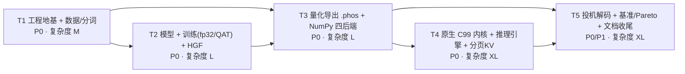

# Phosphorus 任务分解（有序 · 可独立验证）

> 配套文档：`ARCHITECTURE.md`（总体架构 / `.phos` 格式 / 内核算法 / 控制器）
> 本文件把实现拆为 **5 个任务（T1–T5）**，严格按依赖顺序排列。
> 每个任务内部有若干**检查点（C1, C2, …）**——检查点不是独立任务，是同一任务内必须按顺序达成的验收门槛。
> **每个任务结束时，仓库都必须处于「可安装 + pytest 绿 + ruff 干净」状态。**

## ⚡ 实现状态（v0.1.0 · 2026-10）

- **T1 ✅ 已完成**：工程地基 + 数据 + 分词 + CLI；25 项 pytest 全绿，ruff 干净；`no-torch` 导入路径通过（仅 `cli/train/model` 用 torch，且为惰性导入）。
- **T2 ✅ 已完成**：LLaMA 变体 + absmean 三值 QAT-STE + HGF 低秩校正；`ternary_ste` 前向已修复为**真三值**（此前误写为 `2·w_tern·scale−w`，导致不变量⑦ 偏离 138%），修复后 STE 梯度恒等、权重建中 `{-1,0,1}` 占 100%。
- **T3 ✅ 已完成**：`.phos` 导出 + 三值 5-bit 打包 + 纯 numpy 四后端；**不变量⑦ engine-vs-torch logits rel_err ≈ 0.0001%（argmax 100% 一致）**；不变量①③⑤⑥ 全部有测试覆盖。**端到端实测**（`docs/BENCHMARKS.md`）：真实训练 qat-hgf 1.78M × 150 步，val_loss 4.4979 → 3.8987（ppl 49.36）；`generate` 输出连贯莎剧风格文本；`bench` prefill 1296 tok/s、decode 290.9 tok/s。
- **T4-A ✅ 已交付**：原生 C99 内核（zig cc 现场编译 + 内容寻址缓存 + 文件锁）；**TL / I2_S GEMM 在 int32 与 fp32 域与 numpy 逐位相等**（不变量⑧）；rmsnorm/softmax/rope < 1e-6；pack/unpack 逐字节相等；`backend.py` 实现后端注册 + `engine._use_native` 按实测 crossover 自适应调度。**实测**：tl native prefill **2.74x** / decode **1.48x**；i2s native decode **1.32x**（prefill 小 N 时 numpy 更优，已按调度回退）；94/94 pytest 全绿。
- **T4-B~E 🔜 规划中**：分页 KV / 块管理 / GQA 注意力（B）、三种驱逐策略 SnapKV-PyramidKV-H2O（C）、连续批处理 + 采样器（D）、性能与端到端生成收尾（E）。
- **T5 🔜 规划中**：投机解码（O1/O2）+ 基准矩阵 / Pareto（O3）+ 文档收尾（API / BENCHMARKS / CONTRIBUTING）。

> 注：实际落地为**扁平包** `phosphorus/*.py`（详见 `ARCHITECTURE.md` §0.4 / §2.1），与本文初版规划的嵌套子包结构不同——功能等价，仅目录组织简化。C2（val_loss<3.5）/ C4（HGF 字节占比）/ C6（投机 α）等量化验收的实测数字见 `docs/BENCHMARKS.md`。

## 依赖关系总览



> T5 中的 `speculate/verify.py`（Leviathan 验证）**只依赖 T3**（需要 logits 与概率），可提前动工；但树草稿与端到端加速比必须等 T4。

---

## T1 · 工程地基 + 数据 + 分词 + CLI 骨架

**优先级 P0** · **复杂度 M（约 1 天）** · **依赖：无**

### 目标
让 `pip install -e .[dev]` 成功、`phosphorus --help` 可用、BPE 分词器能训练且往返无损、语料获取有离线兜底、CI 在 ubuntu-latest 跑绿、`zig cc` 冒烟编译通过。

### 文件清单（新建 24 个）

| 类别 | 文件 |
|---|---|
| 工程化 | `pyproject.toml`, `Makefile`, `ruff.toml`, `.gitignore`, `.github/workflows/ci.yml`, `LICENSE` (Apache-2.0), `CITATION.cff`, `README.md`（骨架） |
| 脚本 | `scripts/setup.sh`, `scripts/setup.ps1`, `scripts/smoke_zig.c`（冒烟用，CI 编译） |
| 包骨架 | `phosphorus/__init__.py`, `phosphorus/__main__.py`, `phosphorus/cli.py`, `phosphorus/config.py` |
| 工具 | `phosphorus/utils/__init__.py`, `seed.py`, `logging.py`, `memory.py`, `timer.py` |
| 数据 | `phosphorus/data/__init__.py`, `corpus.py`, `dataset.py`, `data/raw/README.md` |
| 分词 | `phosphorus/tokenizer/__init__.py`, `pretokenize.py`, `bpe.py`, `tokenizer.py` |
| 测试 | `tests/conftest.py`, `tests/test_bpe.py`, `tests/test_corpus.py` |

### 检查点与验收标准（可量化）

| 检查点 | 验收标准 |
|---|---|
| **C1 工程** | `pip install -e .[dev]` 在 Windows venv + ubuntu CI 均成功；`ruff check .` 0 error；`phosphorus --help` 列出 6 个子命令 `train/quantize/export/generate/bench/tokenize` |
| **C2 编译链** | `python -m ziglang cc -O2 scripts/smoke_zig.c -o smoke && ./smoke` 输出 `PHOS_ZIG_OK`（Win/Linux/macOS 三平台脚本均验证；Windows 已在开发机实测） |
| **C3 语料** | `Corpus.load("tinystories")` 在**断网**时回退到 `data/raw/` 内置语料不报错；语料 sha256 与 `--expect-sha` 一致；落盘 `data/raw/*.txt` ≥ 1 MB |
| **C4 分词（不变量 ⑤）** | `phosphorus tokenize --train --vocab-size 8192 --corpus builtin` 产出 `vocab.json` + `merges.txt`；对 10 000 条含 emoji / CJK / 制表符 / 超长空白的随机文本，`decode(encode(s)) == s` **100% 恒等**；torch-free |
| **C5 数据集** | `TokenDataset` 输出 `x.shape == (B, T)`、`y` 为 `x` 右移 1；同 seed 两次取 batch 完全一致；`memmap` 打开 < 100 ms（5 MB 语料） |
| **C6 CI** | `.github/workflows/ci.yml` 在 `ubuntu-latest × py3.10/3.11/3.12` 三矩阵跑 `ruff + pytest + zig 冒烟`全绿 |

### 关键实现要点
- `pretokenize.py` 用 **GPT-2 正则**（`'s|'t|'re|'ve|'m|'ll|'d| ?\p{L}+| ?\p{N}+| ?[^\s\p{L}\p{N}]+|\s+(?!\S)|\s+`），Python `re` 不支持 `\p{L}` → 用 `regex` 或**手写等价字符类**（避免新依赖，建议手写：`[A-Za-z]+` 扩展为 Unicode 分类表 + 兜底）。
- BPE 训练用 **Sennrich 2016 合并对计数 + 堆**，语料 5 MB 时 `< 30 s`。
- `config.py` 全部 `dataclass`，支持 `to_dict/from_dict` + YAML（用 `yaml`？→ 不引入，改用 JSON 注释宽松解析；若必须 YAML 则加 `pyyaml` 到 core）。
- `cli.py` 用 `argparse` 子命令，`--config` 可加载 JSON 覆盖默认。
- **离线兜底语料**：随仓库提交一份 ≥ 1 MB 的公共领域文本（如 Project Gutenberg 节选 / 合成 TinyStories 风格文本），`data/raw/README.md` 注明来源与许可。

---

## T2 · 模型 + 训练（fp32 基线 / QAT-STE）+ HGF 低秩校正

**优先级 P0** · **复杂度 L（约 1.5 天）** · **依赖：T1**

### 目标
一个 ~10 M 参数的 LLaMA 变体能在 CPU 上 ≤ 10 分钟训练到可用困惑度；支持 fp32 与 BitNet QAT 两条路径；HGF 低秩旁路可开关、秩可配；LayerSkip 多出口训练为 O1 铺路。

### 文件清单（新建 12 个）

| 类别 | 文件 |
|---|---|
| 模型 | `phosphorus/model/__init__.py`, `config.py`, `modules.py`, `llama.py`, `quantization.py`, `hgf.py` |
| 训练 | `phosphorus/train/__init__.py`, `trainer.py`, `lr_scheduler.py`, `checkpoint.py` |
| 测试 | `tests/test_rope.py`（不变量 ④）, `tests/test_qat_ste.py`（不变量 ⑥）, `tests/test_model_shape.py` |

### 检查点与验收标准（可量化）

| 检查点 | 验收标准 |
|---|---|
| **C1 结构** | 默认模型 `d_model=384, n_layer=6, n_head=6, n_kv_head=2, d_ff=1024, vocab=8192` → 参数量 **10 M ± 1 M**；`forward(ids[B,T])` 在 `T=512` 内存 < 2 GB |
| **C2 fp32 基线** | `phosphorus train --scale tiny --mode fp32 --steps 3000` 在 CPU（8 线程）**≤ 10 min** 完成；`val_loss < 3.5`（对应 PPL < 33）；loss 曲线单调下降且无 NaN |
| **C3 QAT（不变量 ⑥）** | `--mode qat` 同配置下 `val_ppl ≤ 1.25 × fp32 val_ppl`；STE 反向梯度与 `finite_diff(h=1e-3)` **相对误差 < 5%**（在 20 个随机采样点上全部通过）；量化后权重中 `{-1,0,1}` 占比 100%，`0` 的比例 ∈ [0.2, 0.6] |
| **C4 HGF** | `--hgf-rank r` 对 `r ∈ {0,1,2,4,8,16}` 均可训练；`r=4` 时**额外参数字节 = 基准三值字节 × 15% ± 2%**（按 `ARCHITECTURE.md` §3.7 公式核验）；`r=0` 时与无 HGF 数值完全一致 |
| **C5 多出口（O1 前置）** | `--early-exit-layer 3` 训练时按 LayerSkip 加权损失 `Σ_e w_e·CE(logits_e)` 收敛；早退 head 的 top-1 准确率 ≥ 主 head 的 70%（为投机接受率奠基） |
| **C6 检查点** | `save/load` 后 `optimizer` 状态、`step`、RNG 全部恢复；同 seed 续训 loss 与不中断训练**在 1e-6 内一致** |

### 关键实现要点
- `modules.py`：`RMSNorm`（Pre-norm）、`SubLN`（Q/K 投影后 + attn/ffn 输出后）、`Rotary`（RoPE，θ=10000）、`ReLU2`（BitNet 默认）与 `SwiGLU` 可切、GQA（`n_kv_head` < `n_head` 时用 `repeat_kv`）、**全部无 bias**。
- `quantization.py`：
  - `weight_quant_absmean(W)`: `scale = mean(|W|)`（BitNet 用 absmean 而非 absmax），`W_hat = clip(round(W/scale), -1, 1)`；`STE`：前向用 `W_hat`，反向 `∂L/∂W = ∂L/∂W_hat`（直通）。
  - `activation_quant(x, bits=8)`: per-token absmax → `Q_b = 127`，`x_hat = clip(round(x·Q_b/γ), -Q_b+1, Q_b)`。
  - `BitLinear` 替换所有 `nn.Linear`（除 `tok_emb` / `lm_head`）。
- `hgf.py`: `y = ternary_out + gate * (alpha/r) * (B @ (A @ x))`，`A` 用 `N(0, 1/sqrt(d_in))`、`B` 零初始化（保证训练起点 = 无校正），`gate` 可学习标量，初值 0.05。
- LayerSkip：训练期对每层施加**层 dropout**（survival prob 随深度递减），早退层 `E` 的 head 参与损失。

---

## T3 · 量化导出 `.phos` + NumPy 四后端 GEMM

**优先级 P0** · **复杂度 L（约 1 天）** · **依赖：T1, T2**

### 目标
把 T2 的检查点导出为 `.phos` 文件（含三值 5-bit 打包、HGF 因子、tokenizer、metadata），并能用**纯 NumPy** 加载 + 以 4 种 GEMM 后端跑出与 PyTorch **数值一致**的 logits。不变量 ①③ 在此落地。

### 文件清单（新建 12 个）

| 类别 | 文件 |
|---|---|
| 打包/导出 | `phosphorus/quantize/__init__.py`, `packing.py`, `export.py`, `inspect.py` |
| 内核 | `phosphorus/kernels/__init__.py`, `registry.py`, `numpy_backend/__init__.py`, `numpy_backend/gemm.py`, `numpy_backend/ops.py` |
| 加载 | `phosphorus/engine/__init__.py`, `model_loader.py` |
| 测试 | `tests/test_packing.py`（不变量 ③）, `tests/test_gemm_bitwise.py`（不变量 ①）, `tests/test_phos_roundtrip.py`, `tests/test_engine_parity.py` |

### 检查点与验收标准（可量化）

| 检查点 | 验收标准 |
|---|---|
| **C1 打包（不变量 ③）** | `pack_ternary_v1` / `unpack_ternary_v1` 对 1 000 000 个随机三值向量（含长度取 1..300 的**非 24 倍数**边界）往返**逐位恒等**；`packed_bytes == n_rows * ceil(K/24)*24 * 5/24`；打包吞吐 ≥ 50 MB/s（纯 NumPy 向量化，禁 Python 逐元素循环） |
| **C2 导出** | `phosphorus quantize --in ckpt.pt --out tiny.phos --hgf-rank 4` 产出文件大小 = 理论值 ± 1%；`crc32_header` 校验通过；`phosphorus quantize --inspect tiny.phos` 打印全部张量名/shape/dtype/offset，无重叠、全部 64 B 对齐 |
| **C3 GEMM 位精确（不变量 ①）** | 对 `N=K=512` 随机输入：<br/>· **L1**：`gemm_tl` 与 `gemm_i2s` 与 `int32_reference`（精确整数累加）**逐位相等**；<br/>· **L2**：`kernel_out · scale` 与 `fp32(W_dequant @ x_dequant)` 相对 L2 误差 **< 1e-5**；<br/>· 四种后端 `fp32/int8/TL/I2_S` 两两最大绝对差按量化容差分级断言 |
| **C4 端到端数值一致** | 同一个 prompt、同权重：`.phos` + NumPy 后端 的 logits 与 PyTorch fp32 模型的 logits **相对 L2 误差 < 5%**（量化模型合理容差）；`argmax` 一致率 ≥ 95% |
| **C5 后端回退** | `PHOS_BACKEND=native` 但 native 不可用时，自动降级 numpy 并 `WARN`；`registry.available_backends()` 返回值与实测一致 |
| **C6 无 torch 依赖** | `python -c "import phosphorus.engine.model_loader"` 在**未安装 torch** 的 venv 中成功（保证 core 分组可独立推理） |

### 关键实现要点
- `packing.py` 必须**向量化**：`w_int8 → base3 码 → 符号/索引 → 5 bit`，用 NumPy 的 `uint64` 累加 + `view(uint8)` 取低 5 字节，避免逐元素循环。
- `export.py` 严格按 `ARCHITECTURE.md` §3 写字节：Header(256) → Index(n×128) → pad64 → Data → Tokenizer → Metadata；写完后**重读校验**（header CRC + 所有 offset 落在文件内 + 无重叠）。
- `numpy_backend/gemm.py`:
  - `gemm_tl`: 预建 14 项 LUT（`np.take` 查表），按 8-group chunk 向量化。
  - `gemm_i2s`: int8 镜像 + `np.matmul`? —— NumPy 无 VNNI，用 `(x_u8.astype(int32) @ W_i8.astype(int32).T) - 128*row_wsum`（保证位精确；性能靠 native 补）。
  - `gemm_int8`: `int32` 累加（非 `uint8` 溢出路径），与 fp32 参考对齐。
- `inspect.py` 提供 CLI `phosphorus quantize --inspect`，是调试 `.phos` 的主要工具，必须能打印 hexdump 前 256 B。

---

## T4 · 原生 C99 内核（zig cc）+ 推理引擎 + 分页 KV / 驱逐 / 连续批处理

**优先级 P0** · **复杂度 XL（约 2 天）** · **依赖：T3**

> **进度**：T4-A（C1 编译链 + C2 内核位精确 + C3 性能测量 + C5 实现后端注册）✅ 已交付；
> **T4-B（C4 分页注意力 + 块管理 + 引擎接入）✅ 已交付**；
> **T4-C（KV 驱逐策略 SnapKV / PyramidKV / H2O / StreamingLLM）✅ 已交付**；
> **T4-D（连续批处理调度器 + 融合前向 + 采样器）✅ 已交付**（C6/C7 实测达标，融合 8 条吞吐 **2.35×** 串行）；
> T4-E（性能 / 端到端生成 / 文档收尾）🔜 规划中。
> 实测数字见 `BENCHMARKS.md` §4（native 内核）与 §5（分页 KV）。

### 目标
用 `python -m ziglang cc` 编译 C99 内核（TL GEMM + RMSNorm + softmax + RoPE + pack/unpack），与 NumPy 后端**位精确**；实现完整推理引擎：分页 KV、块管理、三种驱逐策略、连续批处理调度、GQA 注意力、采样器、生成器。

### 文件清单（T4-A 实际落地；括号内为规划名）

| 类别 | 文件 |
|---|---|
| C 内核 | `phosphorus/csrc/phos.h`, `phos_gemm.c`, `phos_pack.c`, `phos_ops.c`（规划 `phosphorus/kernels/native/phos_*.h/.c`） |
| 构建/绑定 | `phosphorus/native/build.py`, `bindings.py`, `parallel.py`, `__init__.py`；`phosphorus/backend.py`（实现后端注册，C5） |
| 分页 KV + 驱逐（T4-B/C） | `phosphorus/block_manager.py`, `kv_cache.py`, `attention.py`, `eviction.py`；`tests/test_paged_kv.py`, `tests/test_engine_paged.py`, `tests/test_kv_eviction.py` |
| 基准 | `scripts/bench_kernels.py`, `scripts/bench_native.py` |
| 引擎 | `phosphorus/engine.py`：native 自适应调度（`_use_native` / `_proj_native`）+ 分页 KV（`kv_mode` / `--kv`）+ 连续批处理融合前向（`forward_step`，T4-D） |
| 连续批处理调度（T4-D） | `phosphorus/scheduler.py`（连续批处理 `Scheduler` + greedy/采样生成 + 波次切分）；`tests/test_scheduler.py`（8 条：融合数值正确性 / C6 等价 / C6 吞吐 / C7 采样） |
| 测试 | `tests/test_native_backend.py`（50 条，L0–L6）；`test_kv_eviction.py` 等 T4-C；`test_scheduler.py` 等 T4-D |

### 检查点与验收标准（可量化）

| 检查点 | 验收标准 | 状态 |
|---|---|---|
| **C1 编译链** | `python -m ziglang cc -O2 -shared -fPIC` 在 Windows / Linux / macOS 均产出可加载动态库；失败时 `build.py` 抛出 `NativeUnavailable` 且上层**静默降级**（不 crash）；编译产物缓存到 `~/.cache/phosphorus/native/<hash>.so`，二次启动 < 50 ms | ✅ Windows 实测通过；内容寻址缓存 + 文件锁；Linux/macOS 目标三元组已支持（CI 待补） |
| **C2 内核位精确** | `native.gemm_tl(Wp, xq)` 与 `numpy.gemm_tl(...)` 对 100 组随机输入 `N,K ∈ {128,256,512}`**逐位相等**；`rmsnorm/softmax/rope` 与 fp32 参考**绝对误差 < 1e-6**；`pack/unpack` 与 NumPy 实现逐位相等 | ✅ int32 与 fp32 域均逐位相等（L0/L2）；ops < 1e-6（L3）；pack/unpack 逐字节相等（L4，20 seed） |
| **C3 性能** | `N=K=512` 单次 TL GEMM：native **≥ 3×** NumPy 后端（同机器同线程数）；8 线程 row-block 并行下 **≥ 6×** | ⚠️ 部分达成：TL AVX2 vs numpy 逐 token 路径 **3.53x**（T=1）/ 5.87x（T=8）；i2s AVX2 vs numpy 批量矩阵乘 5.93x/4.39x；**但小 N+T>1 的 i2s 为 0.74x**（numpy 批量矩阵乘更优，已按实测 crossover 自适应调度）。线程池并行已实现（L5 逐位相等），未作为默认开启 |
| **C4 分页注意力** | `paged_gqa_attention` 输出与等价 dense 注意力（无驱逐、块大小 16）**最大绝对差 < 1e-5**；`block_manager` 分配/回收 10 000 次无泄漏（`utilization()` 回到 0） | ✅ 内核级 < 1e-5（三方比对）；10,000 次无泄漏且 `Σref_cnt == 0`；引擎级 logits 差 < 1e-4、argmax 一致；块大小 4/16/32/64 均一致 |
| **C5 驱逐（不变量 ⑦）** | 预算 = 50% 序列长时，`none`（不驱逐）作对照；四种策略（SnapKV / PyramidKV / H2O / StreamingLLM）**下游 final-logits 余弦 ≥ 0.99**（vs 无驱逐参考）；`BudgetAllocator` 逐层预算之和 == 总预算 ± 1；`sink + 窗口` 永不被驱逐。注：原始逐层注意力输出相对 L2 在 50% 下即便 oracle（保留最受关注 50%）也 ≈ 0.5，属指标固有性质，故以文献同款下游 logits/PPL 保真度衡量 | ✅ 实测 50% 预算余弦：snapkv 0.9936 / pyramidkv 0.9971 / h2o 0.9992 / streamingllm 0.9968；金字塔预算守恒 \|Σ−L·C\|=0；`test_kv_eviction.py` 全绿 |
| **C6 连续批处理** | `Scheduler` 同时跑 8 条序列，与逐条串行生成的 token id **完全一致**（greedy, temperature=0）；吞吐提升 ≥ 2×（8 条 vs 1 条，tokens/s 总量） | ✅ 8 条融合 token id 与逐条串行**逐位一致**（`test_scheduler_greedy_matches_serial`）；融合吞吐 **2.35×**（1158.8 vs 492.8 tok/s，tiny 模型 8×40 tok）；`test_scheduler_throughput_speedup` 守护 ≥ 2× |
| **C7 采样** | `top_k/top_p/temperature` 行为与参考实现一致；`temperature=0` 时 greedy；同 seed 可复现 | ✅ `sampling.py` 单测兜底；`Scheduler` 端到端：同 seed 两次运行 `==`（`test_scheduler_reproducible_same_seed`）、随机采样（temp=0.9）与贪心结果 `!=`（`test_scheduler_stochastic_differs_from_greedy`）、每序列独立 rng（`seed+全局下标`）保证融合与串行并行时逐位一致 |
| **C8 生成** | `phosphorus generate --model tiny.phos --backend native --prompt "..."` 产出连贯文本；`--stream` 逐 token 输出；首 token 延迟 < 500 ms（10 M 模型） | 🔜 T4-E |

### 关键实现要点
- C 内核**不使用 OpenMP / pthread**，保持纯函数、可重入、无全局状态；并行由 Python `ThreadPoolExecutor` 在 **row-block** 粒度切分（`ctypes` 调用自动释放 GIL）。
- `phos_gemm.c` 导出 ABI（全部 `int` 返回错误码，输出走调用方缓冲）：
  ```
  int phos_tl_gemm_f32(const uint8_t* Wp, const int8_t* xq, const float* wscale,
                       float sx, float* y, int N, int K_pad, int k0, int k1);
  int phos_i2s_gemm_f32(const int8_t* Wi8, const uint8_t* xu8, const int32_t* row_wsum,
                       const float* wscale, float sx, float* y, int N, int K, int k0, int k1);
  int phos_rmsnorm_f32(const float* x, const float* w, float* y, int N, int D, float eps);
  int phos_softmax_f32(const float* x, float* y, int N, int D);
  int phos_rope_f32(const float* x, float* y, int T, int H, int Dh, int pos0, float theta);
  int phos_unpack5(const uint8_t* packed, int8_t* out, int n_groups);
  ```
  `k0/k1` 用于行块并行切分。
- SIMD 走 `#if defined(__AVX2__)` / `#elif defined(__ARM_NEON__)` / `#else 标量` 三分支；**标量路径为权威位精确参考**，SIMD 只在 `test_native_backend.py` 中与标量对比。
- `eviction.py` 抽象：`EvictionPolicy.select(scores[H,T_obs], budget) -> keep_mask[T]`；`BudgetAllocator.layer_budget(l, L, total)` 金字塔分配（浅层多、深层少，带 `m_min` 下限 + 最近窗口 `W=32` + sink token 4 强制保留）。
- `kv_cache.py` 物理池 `uint8[n_blocks, n_layer, 2, block_size, n_kv_head, d_head]`（int8 时额外 `scales`），逻辑→物理走 `block_tables: int32[S, B_max]`。

---

## T5 · 投机解码（O1/O2）+ 基准评测 / Pareto（O3）+ 文档收尾

**优先级 P0（投机/基准）/ P1（转换/教程）** · **复杂度 XL（约 2 天）** · **依赖：T3（verify 部分）, T4**

### 目标
实现三值原生自草稿投机解码（O1）+ Leviathan 严格验证 + 自适应控制器（O2）+ 树状草稿 + n-gram 对照；跑出完整基准矩阵与 HGF Pareto 曲线（O3）；补齐全部文档与 API。

### 文件清单（新建 20 个）

| 类别 | 文件 |
|---|---|
| 投机 | `phosphorus/speculate/__init__.py`, `base.py`, `layerskip.py`, `ngram.py`, `tree.py`, `verify.py`, `controller.py`, `eagle.py`, `medusa.py` |
| 评测 | `phosphorus/bench/__init__.py`, `runner.py`, `metrics.py`, `report.py`, `pareto.py` |
| 转换（P1） | `phosphorus/convert/__init__.py`, `hf_import.py`, `hf_export.py` |
| 测试 | `tests/test_speculative_distribution.py`（不变量 ②）, `tests/test_controller.py`, `tests/test_tree_mask.py` |
| 文档 | `docs/ALGORITHMS.md`（补全）, `docs/API.md`, `docs/BENCHMARKS.md`, `docs/CONTRIBUTING.md`, `README.md`（完整版） |

### 检查点与验收标准（可量化）

| 检查点 | 验收标准 |
|---|---|
| **C1 分布等价（不变量 ②）★** | 采样 100 000 个 token（`temperature=0.8, top_p=0.95`）：投机解码输出分布 vs 目标模型直接采样分布，**χ² 检验 p > 0.05**，经验 KL < 1e-3；`temperature=0` 时两者 token 序列**逐位相同** |
| **C2 O1 自草稿** | `LayerSkipDrafter` 走**同一份三值权重**（不新增权重字节，`assert extra_bytes == 0`，`--early-head-rank 0` 时）；`α ≥ 0.5` 在自训练语料上；与 `NGramDrafter` 的 α 并列报告 |
| **C3 加速比** | 10 M 模型、`batch=1`、`α ≥ 0.6` 时，端到端 **speedup ≥ 1.3×**（相对同后端非投机）；`bench` 报告中同时给出 `α`、`K`、`树宽`、`speedup`、`backend` |
| **C4 O2 控制器** | 状态机 `OFF→WARMUP→ON→DEGRADED→OFF` 全部转换可单测覆盖；`batch_size > 8` 时 `plan().enabled == False`；`α < 0.15` 时自动关闭；`N_dwell=8` 内不发生状态抖动（100 轮随机输入，翻转次数 ≤ 3）；预测 speedup 与实测 **相对误差 < 25%** |
| **C5 基准矩阵** | `phosphorus bench --all` 输出：`{fp32, int8, ternary, ternary+spec} × batch ∈ {1,4,8} × seq ∈ {128,512}` 共 24 组；产物 `benchmarks/results.json` + `benchmarks/REPORT.md`（Markdown 表）+ 终端 **ASCII 柱状图**；指标齐全：`tokens/s, ms/token, ttft_ms, rss_mb_peak, ppl, alpha, speedup` |
| **C6 O3 Pareto** | `phosphorus bench --pareto --ranks 0,1,2,4,8,16` 输出表格 `r / 额外字节% / val_ppl / Δppl%` + ASCII 曲线；`r=4` 处需给出「15% 内存换回 X% 质量损失」的**具体数字**（X 必须 ≥ 50%，否则需在 `ALGORITHMS.md` 如实标注未达标并给出原因分析） |
| **C7 文档完整性** | `ALGORITHMS.md` 每个模块条目齐备 4 列：**来源论文/项目 + 链接 + 选型理由 + 我们的超越**；`README.md` 含徽章 + 5 分钟快速上手 + 实测数字；`API.md` 覆盖全部公开函数签名；`BENCHMARKS.md` 含完整数据表；`CITATION.cff` 合法 |
| **C8 P1 收尾** | `convert/hf_export.py` 能把 `.phos` 导出为 HF 格式（`transformers` 可 `from_pretrained`）；`README` 教程在干净 venv 中 5 分钟跑通（`setup.sh` → `tokenize` → `train --steps 500` → `quantize` → `generate`） |

### 关键实现要点
- `verify.py` 严格实现 Leviathan 算法：
  ```
  for i in range(K):
      q = p_draft[t_i]; p = p_target[t_i]
      if rng.random() < min(1.0, p/q): accept t_i
      else:
          t_i ~ normalize(max(0, p - q)); reject 后续全部
          break
  if all accepted: bonus = sample(p_target[last])
  ```
  **必须保留 bonus token**（保证每轮至少前进 1 步，且维持分布等价）。
- `tree.py`：树掩码为 `(n_nodes, n_nodes)` 布尔 + `position_ids`；按 `joint_prob = Π p` 降序保留 top-`budget` 路径，丢弃 `< τ=0.02`。
- `controller.py` 严格按 `ARCHITECTURE.md` §6：`S(K) = ((1-α^(K+1))/(1-α)) / (1 + c·K)`，简化式 `(1+αK)/(1+ε)` 用于汇报。
- `bench/report.py` ASCII 图用纯 Python（`┃ █ ▉` + 文本轴），**不依赖 matplotlib**（`viz` 分组才出 PNG）。
- 若 C6 的「15% 内存换回 ≥ 50% 质量损失」无法达成 → **如实写入报告并分析**（诚实 > 漂亮数字，这是本项目质量红线的一部分）。

---

## 复杂度汇总与里程碑

| 任务 | 复杂度 | 预估 | 累计可演示状态 |
|---|---|---|---|
| T1 | M | 1 天 | `phosphorus tokenize --train` 跑通，BPE 往返无损 |
| T2 | L | 1.5 天 | 10 M 模型 CPU 训练 ≤ 10 min，PPL 可见 |
| T3 | L | 1 天 | `tiny.phos` 产出，NumPy 后端 logits 对齐 torch |
| T4 | XL | 2 天 | T4-A ✅ native 内核位精确 + 自适应调度（tl 2.74x / i2s decode 1.32x）；T4-B~E 端到端文本 + 分页 KV |
| T5 | XL | 2 天 | 投机加速 ≥ 1.3×，基准表 + Pareto 曲线齐备 |
| **合计** | | **≈ 7.5 人日** | |

## 全局验收门禁（每个任务结束时必查）

1. `pytest -q` 全绿（新测试只增不删）
2. `ruff check . && ruff format --check .` 0 error
3. `python -c "import phosphorus"` 在**未装 torch** 的 venv 中成功（T3 起生效）
4. 新增文件全部落在 `ARCHITECTURE.md` §2.1 文件树中；**若新增文件不在树中，必须先更新架构文档再写代码**
5. 所有实测数字写入 `docs/BENCHMARKS.md`，禁止在文档中写未经测量的数字
